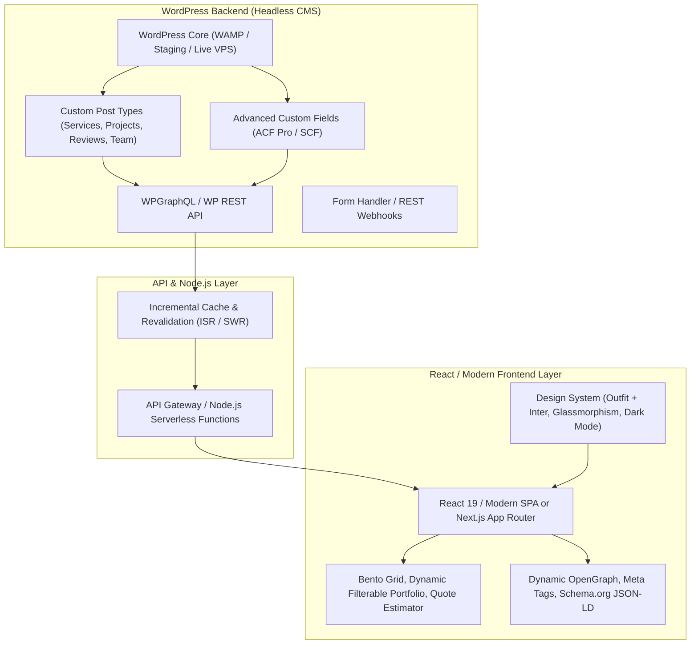
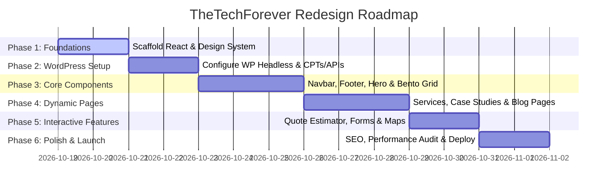

# TheTechForever (TTF) — Official Website Redesign & Headless Architecture Blueprint

> **Project:** TheTechForever Official Corporate Website  
> **Brand Identity:** TheTechForever (IT Services, Web & App Development, Cloud & Consulting)  
> **Architecture:** Headless WordPress (Backend/CMS) + React / Node.js (High-Performance Modern Frontend)  
> **Document Version:** v1.0.0 (Production Roadmap)  
> **Status:** Ready for Execution (Step-by-Step)

---

## 1. Executive Summary & Brand Foundation

**TheTechForever (TTF)** is an established IT solutions, software engineering, and digital transformation company headquartered in Vadodara, Gujarat (Udyam & GST Registered). 

This redesign transitions TTF from a legacy static template into an enterprise-grade, blazing-fast, and decoupled **Headless Web Experience**. 

### 1.1 Brand & Corporate Attributes
- **Company Name:** TheTechForever (TTF)
- **Tagline:** *Empowering Your Digital Future with Scalable Tech Solutions*
- **Headquarters:** Avadh Apartment, Nizampura Gam, Vadodara - 390002, Gujarat, India
- **Official Contact:** `info@thetechforever.com` | `+91 94031 23579`
- **Core Verticals:**
  1. Custom Web Applications & Enterprise Software
  2. Mobile App Development (iOS, Android, Cross-platform React Native / Flutter)
  3. Headless CMS, WordPress & Shopify E-Commerce Solutions
  4. Cloud Solutions, DevOps & Scalable Infrastructure
  5. IT Consulting & Digital Strategy
  6. Managed Web Hosting & Domain Name Services

---

## 2. Headless Architecture Design

The application decouples the content management layer from the presentation layer:



### 2.1 Technology Stack Specifications

| Layer | Recommended Choice | Rationale |
| :--- | :--- | :--- |
| **Backend CMS** | Headless WordPress (PHP 8.2+, MySQL) | Seamless content editing, media management, rich ecosystem, client-friendly WP admin. |
| **Data Fetching** | WP REST API & WPGraphQL | Structured data retrieval with sub-millisecond response times, zero payload bloat. |
| **Frontend Framework** | React (Vite SPA with SSR capability or Next.js App Router) | Blazing-fast client interactions, instant HMR, superior developer experience, component modularity. |
| **Styling & Design System** | Modern Vanilla CSS / Tokenized Custom Properties | Zero bloat, total design freedom, fluid typography, native glassmorphism, responsive CSS grid. |
| **State Management** | React Context + React Query / SWR | Automated background cache revalidation, seamless loading states, instant optimistic updates. |
| **Icons & Media** | SVG Sprite System + Lucide Icons + Optimized WebP/AVIF | Crisp vector icons on high-DPI displays with ultra-low latency. |
| **Form Handling & Lead Capture** | React Hook Form + WordPress REST / Node Emailer | Zero spam with Honeypot protection, instant email notification to `info@thetechforever.com`. |

---

## 3. Design Language & Visual Aesthetics ("WOW" Factor)

To distinguish TheTechForever as an elite software engineering agency, the design adheres to modern web standards:

1. **Aesthetic Direction:** Modern Dark-Obsidian theme with neon-accented glassmorphism, interactive glowing gradients, and fluid typography.
2. **Color Palette:**
   - **Canvas Background:** `#0a0b10` (Deep Space Obsidian)
   - **Surface / Card Background:** `rgba(18, 22, 34, 0.75)` with `backdrop-filter: blur(16px)`
   - **Primary Brand Accent:** `#0066FF` / `#00d4ff` (Electric Blue to Cyan Gradient)
   - **Secondary Accent:** `#7928CA` / `#b800e6` (Neon Cyber Purple)
   - **Text Primary:** `#F8FAFC` (Pure Titanium White)
   - **Text Muted:** `#94A3B8` (Slate Silver)
   - **Border & Glass Highlight:** `rgba(255, 255, 255, 0.08)` to `rgba(0, 102, 255, 0.3)`
3. **Typography:**
   - **Headings & Brand Title:** `Outfit`, sans-serif (Weights: 600, 700, 800) — geometric, authoritative, modern tech feel.
   - **Body & UI Elements:** `Inter`, sans-serif (Weights: 400, 500, 600) — maximum readability and crisp UI rendering.
4. **Micro-Interactions & Animation:**
   - Ambient glowing mesh gradients floating smoothly behind hero elements.
   - Interactive Bento Grid cards with subtle hover lift and radial gradient flashlights.
   - Live project filter pills with fluid sliding indicator.
   - Dynamic counter for company milestones (100+ Projects, 50+ Clients, 5+ Years, 99.9% Uptime).

---

## 4. Feature Architecture & Page Specifications

### 4.1 Header & Navigation (Global)
- **Brand Identity:** High-resolution TTF logo (responsive switch between compact icon and full rectangle mark).
- **Navigation Links:**
  - Home
  - Services (Mega-menu / Dropdown highlighting: Web Dev, Mobile Dev, Cloud, Consulting, E-Commerce, Hosting)
  - Portfolio / Case Studies
  - About Us
  - Tech Stack & Solutions
  - Blog & Insights
  - Contact Us (Glowing Call-to-Action button)
- **Utility Bar:** Mobile slide-out drawer, theme accent indicator, quick call/email button.

### 4.2 Home Page (Hero to Footer Conversion Funnel)
1. **Hero Section:**
   - High-impact headline: *"Architecting Next-Generation Digital Experiences & Scalable Cloud Solutions."*
   - Interactive dual CTAs: **"Start Your Project"** (opens interactive estimator) & **"Explore Services"**.
   - Trust badge strip: Technologies used (React, Node, WordPress, AWS, Docker, Python, Flutter).
2. **Key Metric Counter Strip:**
   - 100+ Digital Solutions Shipped | 50+ Global Clients | 99.9% SLA & Uptime | 24/7 Dedicated Support.
3. **Bento Grid of Core Services:**
   - **Web Engineering:** Next-gen SPAs, custom portals, high-converting eCommerce.
   - **Mobile App Innovation:** Native iOS/Android & cross-platform Flutter/React Native.
   - **Cloud Infrastructure & DevOps:** CI/CD pipelines, AWS/GCP migration, microservices.
   - **Enterprise CMS & WordPress:** Headless architecture, custom plugin/theme development.
   - **IT Consulting & Architecture:** Security audits, technical scoping, digital roadmaps.
   - **Domain & Cloud Hosting:** Fast, secure, enterprise-grade deployment and management.
4. **Interactive Tech Stack Showcase:**
   - Filterable tabs: *Frontend*, *Backend & CMS*, *Mobile*, *Cloud & Database*, *DevOps*.
5. **Featured Case Studies / Portfolio Highlights:**
   - Interactive cards with live links, tech tags, client problem statement, and delivered solution.
6. **Our Proven 4-Step Engineering Process:**
   - 01. Discovery & Architecture -> 02. UI/UX & Prototyping -> 03. Agile Development & Testing -> 04. Deployment & Scaled Growth.
7. **Client Testimonials & Trust Carousel:**
   - Real reviews, star ratings, and company badges.
8. **Interactive Project Cost / Scope Estimator (Lead Magnet):**
   - Step 1: Select Project Type (Web, Mobile, Cloud, Full Suite).
   - Step 2: Select Timeline & Scope.
   - Step 3: Enter Contact Details to receive instant custom proposal.
9. **Final Conversion Banner (CTA):**
   - High-contrast banner with direct WhatsApp & phone consultation buttons.

### 4.3 Services Hub & Individual Service Pages
- Dedicated deep-dive routes for each service:
  - `/services/web-development`
  - `/services/mobile-apps`
  - `/services/cloud-solutions`
  - `/services/wordpress-cms`
  - `/services/it-consulting`
  - `/services/hosting-domains`
- Includes: Detailed feature matrix, tech stack used, FAQs for the specific service, and case study links.

### 4.4 Portfolio & Case Studies Hub (`/portfolio`)
- Category filters: All, Web Applications, Mobile Apps, Headless & eCommerce, Cloud Infrastructure.
- Single Project View (`/portfolio/[slug]`):
  - Challenge faced by client
  - TheTechForever Architecture & Solution
  - Technology stack badges
  - Screenshots / Mockup gallery
  - Measurable business impact / metrics (e.g. +300% performance, zero downtime).

### 4.5 About Us Page (`/about`)
- The story of TheTechForever and vision for modern engineering.
- Leadership, core team culture, and values (Integrity, Innovation, Agility, Client First).
- Official credentials: GST, Udyam MSME Registration, Vadodara Tech Hub presence.

### 4.6 Blog & Insights Hub (`/blog`)
- Sourced dynamically via Headless WordPress REST/GraphQL API.
- Search bar with instant client-side filtering.
- Categories: Tech Trends, Web Dev, Cloud Best Practices, Tutorials, Business Case Studies.
- Single post template with reading time, table of contents, author card, and social share links.

### 4.7 Contact & Consultation Page (`/contact`)
- Interactive inquiry form with file attachment capability for RFPs/project briefs.
- Direct contact details:
  - Phone: `+91 94031 23579` (click-to-call)
  - Email: `info@thetechforever.com` (click-to-email)
  - Address: Avadh Apartment, Nizampura Gam, Vadodara - 390002
- Embedded interactive Google Map location.
- Live operating hours and emergency support SLA information.

### 4.8 Footer (Global)
- Company bio & official logo.
- Comprehensive quick navigation links categorized by Services, Solutions, and Legal.
- Social media icon links (LinkedIn, Twitter/X, Facebook, Instagram, GitHub).
- Registered copyright, privacy policy, and terms of service.

---

## 5. Headless WordPress Backend Data Modeling (Powered by Secure Custom Fields - SCF)

WordPress serves as the Headless CMS content engine, utilizing **Secure Custom Fields (SCF)** (`secure-custom-fields` plugin located in `E:\wamp64\www\TTF\wp-content\plugins\secure-custom-fields`) to manage structured data without database bloat.

### 5.1 Custom Post Types & SCF Field Groups

1. **`services`** (Services Catalog)
   - **SCF Field Group:** `service_metadata`
   - **Fields:**
     - `tagline` (Text): Punchy service tagline.
     - `short_description` (Textarea): Brief summary for cards.
     - `icon_name` (Text / Select): Lucide icon identifier (e.g. `Globe`, `Smartphone`, `Cloud`, `LayoutTemplate`, `Compass`, `Server`).
     - `badge` (Text): Tag pill (e.g. `Popular`, `Enterprise`, `99.9% SLA`).
     - `full_description` (WYSIWYG / Textarea): In-depth architectural explanation.
     - `features` (Repeater / Textarea newline-delimited): Key capabilities bullet list.
     - `deliverables` (Repeater / Textarea newline-delimited): Guaranteed client deliverables.
     - `tech_stack` (Text / Tags): Comma-separated technologies used.
     - `starting_price` (Text): Baseline pricing tier.

2. **`portfolio`** (Case Studies & Client Projects)
   - **SCF Field Group:** `portfolio_metadata`
   - **Fields:**
     - `client_name` (Text): Client or company name.
     - `category` (Text): Display category (e.g. `Web Applications`, `Mobile Apps`, `Headless CMS`).
     - `category_slug` (Select): Filter key (`web`, `mobile`, `cms`, `cloud`).
     - `summary` (Textarea): Executive problem/outcome summary.
     - `challenge` (Textarea): The client's original engineering bottleneck.
     - `solution` (Textarea): TheTechForever architecture & implementation.
     - `metrics` (Repeater / Textarea): Quantifiable business impact metrics (e.g. `+74% Faster Page Speed`).
     - `tags` (Text): Comma-separated tech stack used.
     - `featured` (True/False): Toggle for homepage showcase.
     - `live_url` (URL): Direct project URL.

3. **`testimonials`** (Client Reviews)
   - **SCF Field Group:** `testimonial_metadata`
   - **Fields:**
     - `client_name` (Text): Full reviewer name.
     - `role` (Text): Designation / Title.
     - `company` (Text): Client company name.
     - `rating` (Number 1-5): Star rating.
     - `quote` (Textarea): Review text.
     - `avatar_initials` (Text): Fallback monogram.

4. **`faqs`** (Technical & Collaboration FAQs)
   - **SCF Field Group:** `faq_metadata`
   - **Fields:**
     - `question` (Text): FAQ question.
     - `answer` (Textarea): Detailed answer.
     - `category` (Select): `Architecture`, `Process`, `Migration`, `Support`.

### 5.2 Secure Custom Fields (SCF) REST API Exposure

In `wordpress-integration/ttf-headless-core.php`, all SCF fields are automatically exposed on REST API responses via `register_rest_field()` under the `scf` key (with `acf` alias for backward compatibility):

```php
// Automatically attached to /wp-json/wp/v2/services, portfolio, posts, testimonials
register_rest_field($cpt, 'scf', array(
    'get_callback' => function($post_arr) {
        return function_exists('get_fields') ? get_fields($post_arr['id']) : get_post_meta($post_arr['id']);
    }
));
```

The React frontend (`src/api/wordpress.js`) parses `item.scf || item.acf || {}` directly, falling back gracefully to `src/data/mockData.js` during local offline testing.

---

## 6. Comprehensive Implementation Roadmap & Todo List



### Phase 1: Foundations & Architecture Setup
- [ ] Initialize clean React 19 + Vite modern frontend structure.
- [ ] Establish design tokens in `index.css` (Colors, Spacing, Glassmorphism, Modern Outfit & Inter typography).
- [ ] Configure routing (SPA router / Multi-page router with dynamic slugs).
- [ ] Set up API client service layer (`src/api/wordpress.js`) with failover mock data for offline development.

### Phase 2: Headless WordPress Backend Configuration
- [ ] Review existing WordPress setup in `E:\wamp64\www\TTF`.
- [ ] Enable REST API & WPGraphQL support.
- [ ] Register Custom Post Types (`services`, `portfolio`, `testimonials`, `faqs`).
- [ ] Expose ACF custom fields via REST API endpoint extensions.
- [ ] Configure CORS headers in `.htaccess` or `functions.php` to allow frontend requests.
- [ ] Create contact form inquiry webhook endpoint.

### Phase 3: Global Layout & Navigation Shell
- [ ] Build responsive Glassmorphic Navbar with mobile drawer and active link states.
- [ ] Integrate official TTF brand logos (`logo-rect.png`, `logo-square.png`).
- [ ] Build global Footer with complete contact info, quick links, and social media handles.
- [ ] Implement smooth scroll, back-to-top button, and page transition effects.

### Phase 4: Homepage & Core Conversion Sections
- [ ] Build Ambient Hero section with headline, glowing gradient blobs, and action buttons.
- [ ] Build animated Stats & Achievements ticker (100+ Projects, 50+ Clients, etc.).
- [ ] Build Bento Grid Services showcase with interactive hover states.
- [ ] Build Interactive Tech Stack Filter (Frontend, Backend, Mobile, Cloud, DevOps).
- [ ] Build Featured Portfolio Highlights carousel/grid.
- [ ] Build Client Testimonials slider.

### Phase 5: Dynamic Pages (Services, Portfolio, About, Blog)
- [ ] Build Services Hub (`/services`) and dynamic service detail page template.
- [ ] Build Portfolio Showcase (`/portfolio`) with real-time category filtering.
- [ ] Build Single Case Study view (`/portfolio/:slug`) highlighting client challenge and results.
- [ ] Build About Us page (`/about`) with company history, values, and registration info.
- [ ] Build Blog Hub (`/blog`) and Single Article view (`/blog/:slug`) with Headless WP sync.

### Phase 6: Interactive Lead Generation & Contact Tools
- [ ] Build Interactive Project Scope & Cost Estimator widget.
- [ ] Build validated Contact Form with real-time feedback and Honeypot spam prevention.
- [ ] Integrate WhatsApp Floating Quick-Chat button.
- [ ] Integrate Google Maps location embed for Vadodara headquarters.

### Phase 7: Optimization, SEO & Production Deployment
- [ ] Implement dynamic SEO meta tags (OpenGraph, Twitter Cards, Canonical URLs).
- [ ] Add Schema.org structured data (`Organization`, `LocalBusiness`, `ProfessionalService`).
- [ ] Optimize images with lazy loading, WebP format, and exact aspect ratios.
- [ ] Cross-browser and multi-device responsive testing (Mobile, Tablet, Laptop, 4K).
- [ ] Configure deployment environment (Vite build / Node.js production server / Hostinger / VPS).

---

## 7. Immediate Next Step

With this blueprint fully established, we are ready to commence **Phase 1: Project Scaffolding & Design System Implementation**.

Please review the architecture and confirm to initiate Step 1!
